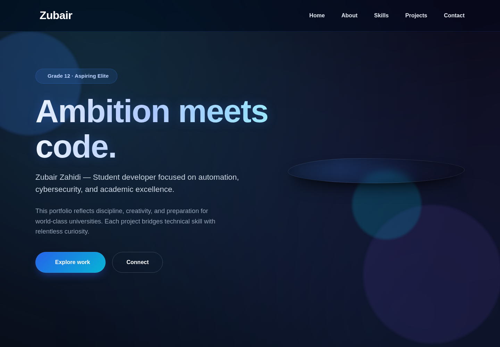

# Portfolio Iterations

Five personal portfolio iterations documenting experiments with responsive layouts, project galleries, and animated interfaces. The repository documents a progression in design choices rather than a single deployed application.

## Explore the versions

| File | Version |
| --- | --- |
| `portfolio_1.html` | First iteration |
| `Portfolio_2.html` | Second iteration |
| `Portfolio_3.html` | Third iteration |
| `Portfolio_4.html` | Fourth iteration |
| `Portfolio_5.html` | Fifth iteration |

Open a version in a browser, or run `python -m http.server 8000` from the repository and navigate to its filename. Preserve the exact capitalization when serving files on systems with case-sensitive paths.

## Design focus

The versions explore dark surfaces, visual hierarchy, project galleries, and CSS/JavaScript interactions. Review each page on the target devices before reusing it; no universal accessibility or performance result is claimed.

Created by **Zubair Zahidi**. See [the current GitHub profile](https://github.com/Zubair-zahidi) for recent work.

## Cloud review preview

Captured from the running project on 22 October 2026. This is a static portfolio page served by a local HTTP server.
