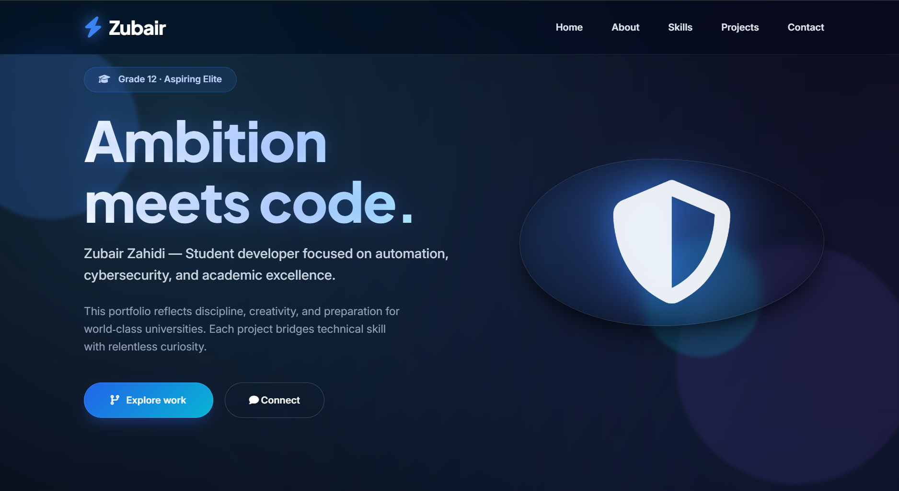
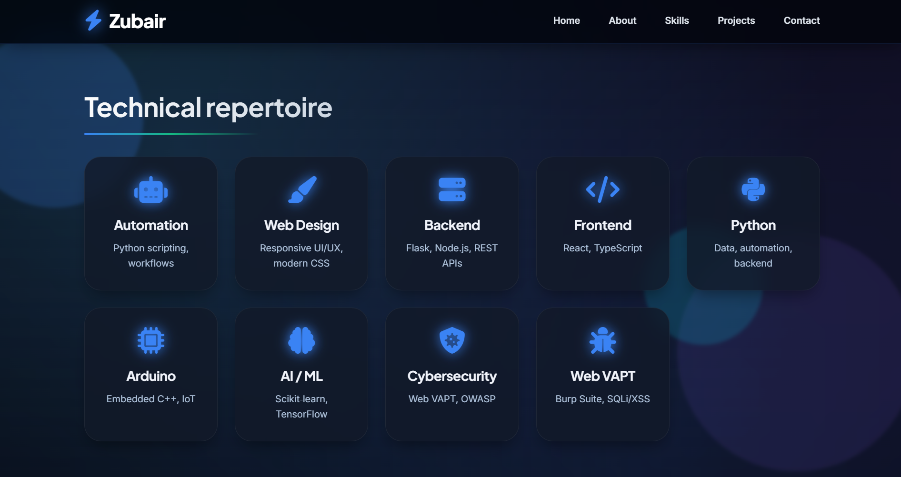
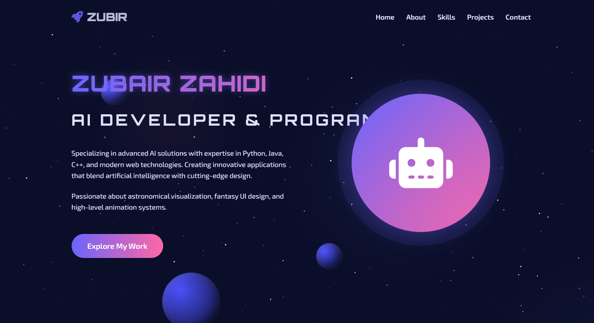
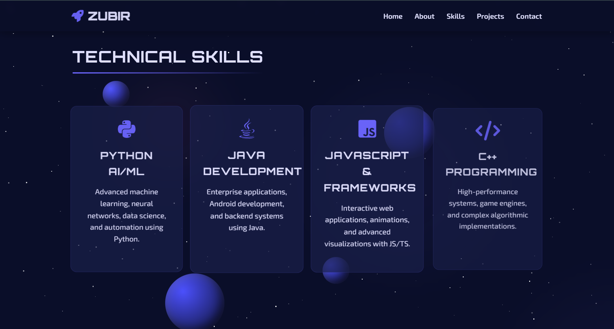
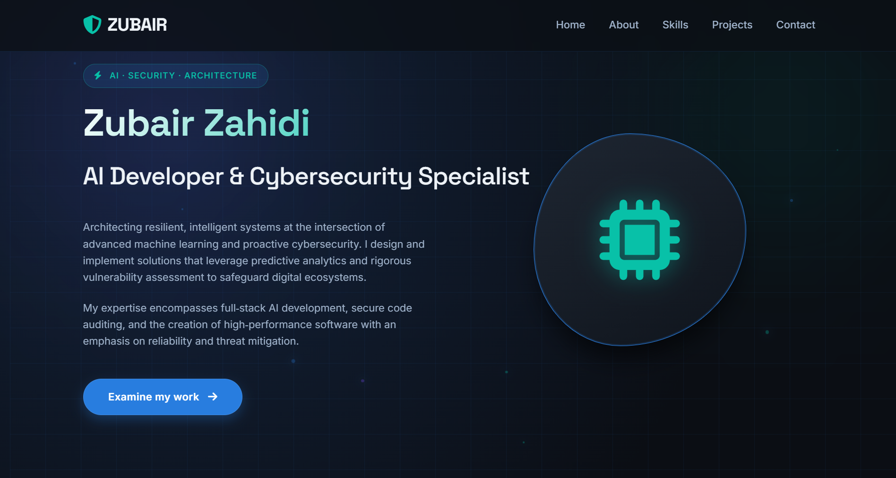
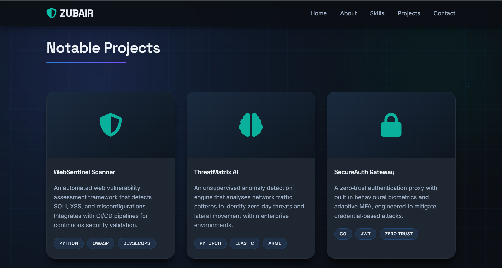
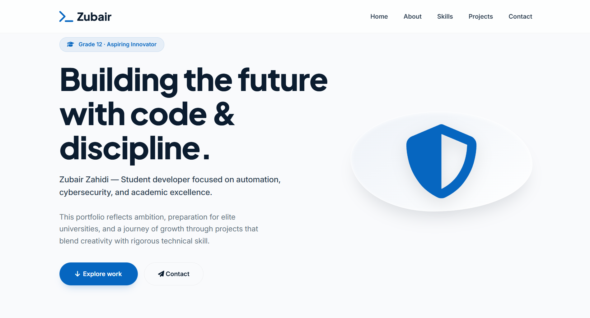
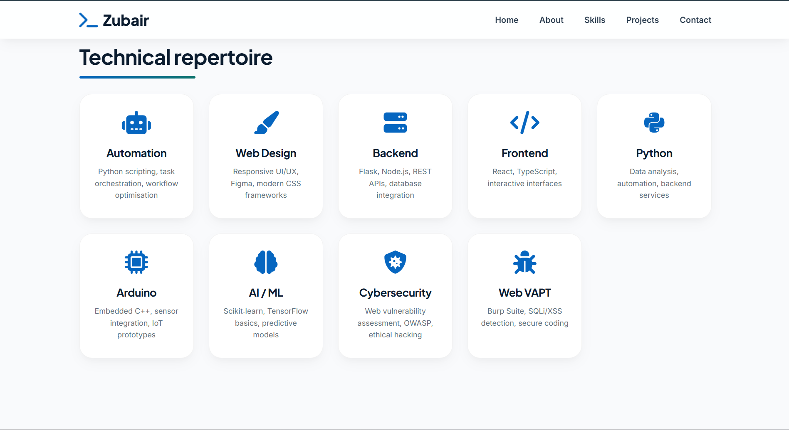
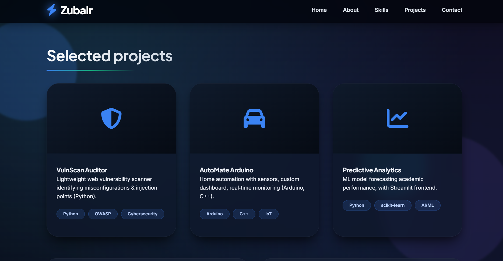

# Zubair Zahidi · Student Developer Portfolio

A meticulously crafted, multi-iteration personal portfolio that reflects ambition, discipline, and technical proficiency. Designed to showcase a Grade 12 student's journey in automation, cybersecurity, web development, AI/ML, and embedded systems — with a strong emphasis on preparation for elite university admissions.

## 🧠 Overview

This repository chronicles the evolution of my portfolio website through **five distinct iterations** (`portfolio_1` → `portfolio_5`). Each version demonstrates growth in design sophistication, code quality, and feature depth.

The final version (`portfolio_5`) represents a pinnacle of modern web design: a dark-themed, glass‑morphic interface with animated gradient backgrounds, smooth micro‑interactions, and comprehensive sections for skills, projects, and contact.

## ✨ Key Features

- **Responsive & Adaptive** – Flawless display on all devices.
- **Dark Glassmorphism UI** – Premium aesthetic with backdrop blur and neon accents.
- **Dynamic Animated Background** – CSS mesh gradients and floating particles.
- **Skills Showcase** – Covers automation, web design, backend, frontend, Python, Arduino, AI/ML, cybersecurity, and web vulnerability assessment.
- **Project Gallery** – Highlights real-world projects with tech tags.
- **Contact & Social Integration** – Ready for networking and opportunities.
- **Performance Optimized** – Minimal dependencies, smooth scrolling, and lazy‑loading animations.

## 🛠️ Technologies & Skills

| Category               | Tools & Technologies                                                                 |
|------------------------|--------------------------------------------------------------------------------------|
| **Languages**          | Python, JavaScript (ES6), C++ (Arduino), HTML5, CSS3                                  |
| **Frontend**           | React (basics), TypeScript, Tailwind-inspired custom CSS, Font Awesome                |
| **Backend**            | Flask, Node.js, REST API design                                                       |
| **AI/ML**              | scikit‑learn, TensorFlow (intro), Pandas, NumPy                                       |
| **Cybersecurity**      | OWASP Top 10, Burp Suite, SQLi/XSS detection, secure coding practices                |
| **Automation**         | Python scripting, workflow orchestration                                              |
| **Embedded**           | Arduino (C++), sensor integration, IoT prototyping                                    |
| **Design**             | Figma, responsive layouts, glassmorphism, modern UI/UX                                |

## 📸 Screenshots – Evolution Gallery

Below are **11 screenshots** capturing the journey from initial concept to final refined design.  
*(Replace each placeholder with the actual image file you have saved.)*

### 🔹 Portfolio v1 (Initial)
| | |
|:---:|:---:|
|  |  |

### 🔹 Portfolio v2 (Cosmic / Fantasy)
| | |
|:---:|:---:|
|  |  |

### 🔹 Portfolio v3 (Professional Tech)
| | |
|:---:|:---:|
|  |  |

### 🔹 Portfolio v4 (Clean Academic)
| | |
|:---:|:---:|
|  |  |

### 🔹 Portfolio v5 (Ultimate Dark Glass)
| | |
|:---:|:---:|
|  |  |
|  | |

**Total: 11 images**  
> *Note: Ensure all image files are placed in the repository root or an `/img` folder and update the paths accordingly.*

## 📂 Repository Structure
